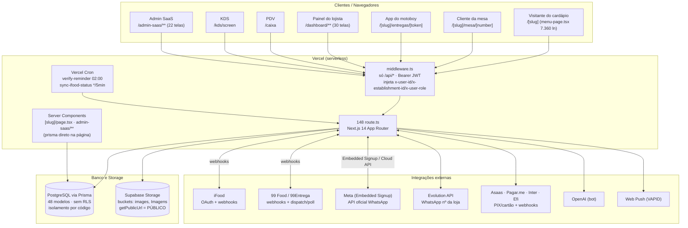
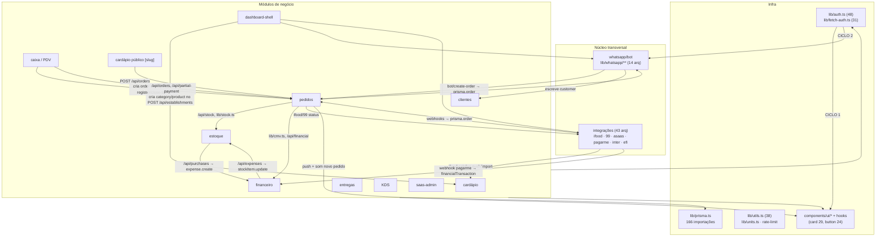
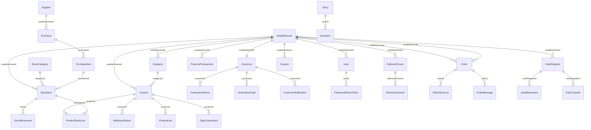
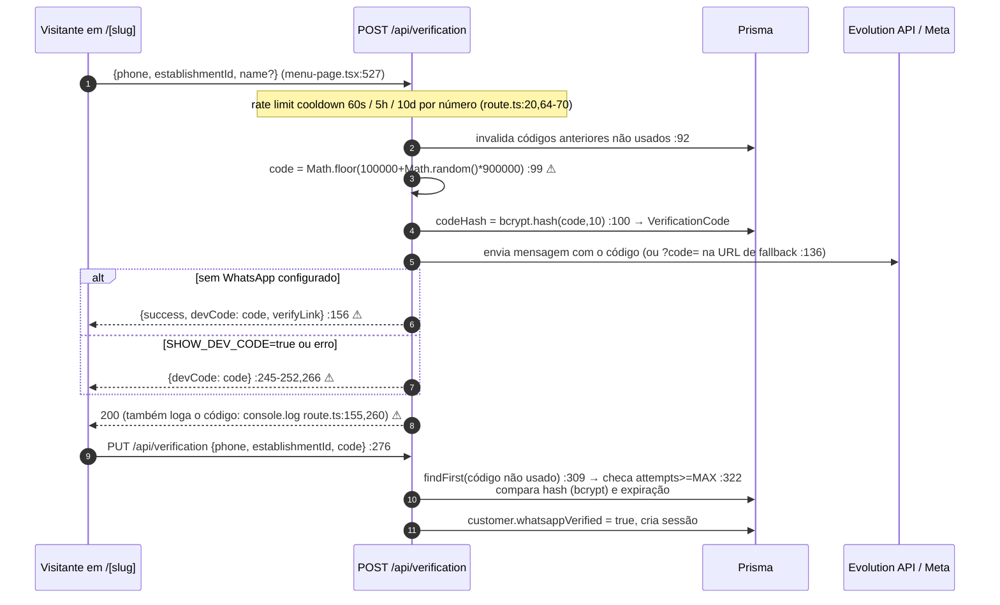

# FASE 0B — ARQUITETURA E DIAGRAMAS

**Data:** 08/10/2026 · **Regras:** seção 2 · ER completo gerado em `/auditoria/00-er-completo.mmd` (820 linhas, 48 modelos, 50 relações).

---

## 1. Arquitetura geral



**Pontos estruturais observados:**
- Não há camada de serviço: as `route.ts` são a lógica de negócio; os `page.tsx` de admin fazem `prisma.*` direto (Server Components) — ver §3.4.
- Não há fila/filas de jobs: webhooks de iFood/99/PSP são processados inline na requisição (`vercel.json` só tem 2 crons).
- Não há Realtime: KDS e painel usam **polling** (`/api/orders/ifood-poll`, `/api/delivery/poll-99`, `dashboard/pedidos/page-content.tsx:109`).
- `middleware.ts:46-48` não valida **nenhuma rota de página** — apenas `/api/*`.

---

## 2. Grafo de dependência ENTRE MÓDULOS

Metodologia: 333 arquivos, 594 arestas de import resolvidas (0 pendências), 308 nós / 591 arestas finais. Como o acoplamento real entre domínios no App Router acontece por **HTTP** e por **escrita no banco**, foram montados 3 grafos (imports, chamadas `/api`, escritas em tabelas alheias).



### 2.1 Ciclos de dependência

**Ciclos de importação arquivo-a-arquivo: NENHUM.** Tarjan/SCC sobre 308 nós × 591 arestas → 0 componentes fortemente conexos; brute-force de ciclos até comprimento 5 → 0. **A base ESM está saudável.**

**Ciclos de módulo (fronteira de domínio) — 2 reais:**

| ID | Ciclo | Evidência |
|---|---|---|
| C1 | `auth ↔ infra-ui` | auth→UI: `src/app/login/page.tsx:6`, `cadastro/page.tsx:6`, `esqueci-senha/page.tsx:5-8`, `redefinir-senha/page.tsx:6-9`, `trocar-senha/page.tsx:6-9` (14 arestas). UI→auth: `src/components/meta-embedded-signup.tsx:6`, `meta-quota-card.tsx:5` (`fetchAuth`) |
| C2 | `auth ↔ whatsapp-bot` | auth→bot: `src/app/api/verification/route.ts:3` (`getWhatsAppProvider`) e `:168,:199` (`await import("@/lib/whatsapp/meta")`). bot→auth: `src/app/dashboard/(auth)/chat/page-content.tsx:19` |

**Ciclo "a um passo" (fragilidade):** `src/lib/use-new-order-alerts.ts:2` importa `@/components/sound-control` (**lib → componente UI**, camada invertida); qualquer import de `use-new-order-alerts` a partir de `components/` fecha um ciclo ESM imediato.

**Ciclo via banco — o mais grave:** **17 módulos escrevem em tabela de outro módulo** sem passar pelo dono. Exemplos:

| Escritor | Tabela alheia | Evidência |
|---|---|---|
| caixa | Order | `src/app/api/cash-register/close-table/route.ts:25` (`prisma.order.create`), `:76` (`update`) |
| financeiro | StockItem | `src/app/api/expenses/route.ts:245` |
| estoque | Expense | `src/app/api/purchases/route.ts:132` |
| dashboard-shell | Category/Product | `src/app/api/establishments/route.ts:80,84` |
| integrações PSP | Order (12 escritas) | `api/payments/{asaas/card,pagarme/card,inter/{webhook,qr-code},sync,efi}`, `api/webhooks/{asaas,pagarme,99,efi}` |
| pedidos | Customer/CustomerNotification | `src/app/api/orders/route.ts:198,217,321,370,480` |
| whatsapp-bot | Establishment/Customer | `src/app/api/webhooks/whatsapp/route.ts:144,287,467` |
| entregas | Order/User | `src/app/api/delivery-persons/deliveries/route.ts:81` |

### 2.2 Módulos que "sabem demais" (Top 10)

| # | Arquivo | Linhas | Módulos alcançados (HTTP) | Por que sabe demais |
|---|---|---|---|---|
| 1 | `src/app/[slug]/menu-page.tsx` | **7.360** | 6 (pedidos, cardápio, clientes, entregas, cupons, dashboard) | carrinho + cupom + fidelidade + cashback + desconto 1ª unidade + taxa de entrega + OTP + tracking + push; importa `orders-screen` **e** `order-confirmation-screen` (`:16,17`) |
| 2 | `src/app/dashboard/(auth)/cardapio/page-content.tsx` | **4.598** | 4 (28 endpoints) | calcula **CMV**, **markup iFood** e **preço sugerido** dentro da UI (`:219-258`) |
| 3 | `src/app/dashboard/(auth)/config/page-content.tsx` | **3.178** | 2 (12 endpoints) | orquestra Asaas, iFood e 6 endpoints Meta/WhatsApp |
| 4 | `src/app/caixa/caixa-page.tsx` | **3.088** | 6 (16 endpoints) | POS orquestrando 9 domínios |
| 5 | `src/app/api/orders/route.ts` | **758** | pedido + fidelidade + estoque + CMV + PIX de 3 PSPs (`:3-7,584,594`) | imports `asaas`, `inter`, `cmv`, `units`, `stock`, `pagarme` |
| 6 | `src/app/api/orders/[id]/route.ts` | **586** | ifood + 99 + whatsapp + estoque + push (10 imports, `:3-8,258,311,472`) | — |
| 7 | `src/app/dashboard/(auth)/layout.tsx` | **631** | reimplementa `isOpenNow()` (`:502-524`) e decide status iFood (`:530`) — **regra de operação num layout de navegação** |
| 8 | `src/app/dashboard/(auth)/pedidos/page-content.tsx` | **1.249** | decide transições de status/handshake na UI (`:577-614`) |
| 9 | `src/app/dashboard/(auth)/estoque/page-content.tsx` | **1.279** | 12 endpoints, alerta de mínimo calculado na tela (`:144`) |
| 10 | `src/app/api/webhooks/whatsapp/route.ts` | **593** | bot + OpenAI + prompt + quick-replies (`:4-7,15,574`) |

> **Os 4 maiores arquivos somam 18.224 linhas = 28% de todo `src/`.**

### 2.3 Hubs de `src/lib/`

| # | Arquivo | Importado por |
|---|---|---|
| 1 | `src/lib/prisma.ts` | 166 |
| 2 | `src/lib/auth.ts` | 48 |
| 3 | `src/lib/utils.ts` | 38 |
| 4 | `src/lib/fetch-auth.ts` | 31 |
| 5 | `src/lib/saas-admin-auth.ts` | 11 |
| 6 | `src/lib/pagarme-config.ts` | 11 |

Os 4 primeiros concentram **283 das 594 arestas**. Achado adicional: `src/lib/saas-admin-auth.ts:5` cria **`new PrismaClient()` próprio**, ignorando o singleton de `src/lib/prisma.ts` (quebra cache e `beforeExit`).

### 2.4 SQL/Prisma fora da camada de API

**14 `page.tsx` + 1 `route.ts` dentro de pasta de página** usam `prisma.*` direto:

- `src/app/admin-saas/(auth)/dashboard/page.tsx:20-42` (10 queries) e **`:66` `$queryRaw SELECT 1`**
- `src/app/admin-saas/(auth)/estabelecimentos/[id]/page.tsx:35` — `$queryRaw SELECT "value" FROM "SystemConfig" WHERE "key"='pagarme_config'`
- **`src/app/admin-saas/(auth)/estabelecimentos/[id]/api/route.ts:11`** — `route.ts` fora de `/api` dentro da pasta da página
- `src/app/pedido/[id]/page.tsx:52` — **página pública grava pedido** (`prisma.order.update`), `:72`, `:87`
- `src/app/[slug]/page.tsx:26,65`, `[slug]/layout.tsx:5`, `[slug]/mesa/[number]/page.tsx:13`, `[slug]/staff/page.tsx:11`, `admin/page.tsx:6` + 6 páginas de `admin-saas`

`src/components/**` e `src/hooks/**`: **0** usos de prisma (limpo).

### 2.5 Lógica duplicada front ⇄ back com divergência real (alimenta Fase 5)

| ID | Regra | Front | Back | Divergência |
|---|---|---|---|---|
| D1 | `isOpenNow()` — **4 implementações** | `dashboard/(auth)/layout.tsx:502-524`; `menu-page.tsx:750` | `lib/whatsapp/bot-rules.ts:32-57`; `api/cron/sync-ifood-status/route.ts:8-28` | sem config: bot diz **ABERTO** (`bot-rules.ts:36`), layout diz **FECHADO** (`layout.tsx:503`) — respostas opostas |
| D2 | `getNextOpeningTime()` | — | `cron/sync-ifood-status/route.ts:30-54` vs `establishments/[id]/toggle-open/route.ts:9-49` | um usa `h.day.trim()`, o outro não (`:9`) → não acha o dia com espaço |
| D3 | CMV / custo | `cardapio/page-content.tsx:229-245` (reais) | `lib/cmv.ts:50-76` (centavos) | mesma fórmula em 2 unidades diferentes |
| D4 | Markup `custo/(1-margem)` — **5 lugares** | `cardapio/page-content.tsx:225,548,597`; `financeiro/cmv/page-content.tsx:44` | `api/products/update-prices/route.ts:81` | — |
| D5 | Markup iFood | `cardapio/page-content.tsx:246-258` | `api/ifood-catalog/push/route.ts:301` | — |
| D6 | **Subtotal `discountAppliesTo = "first_only"`** | `menu-page.tsx:1383-1386` aplica desconto só na 1ª unidade | `api/orders/route.ts:93` usa `item.price` (já descontado) × qtd → **desconto em TODAS** | **divergência de dinheiro no pedido** |
| D7 | **Total** | `menu-page.tsx:1466` | `api/orders/route.ts:91-98` (`never trust client-sent total`) mas aceita do body: `deliveryFee`, `loyaltyDiscount`, `couponDiscount`, `firstPurchaseDiscount` (`:75`) sem revalidar minOrder/saldo/cupom | servidor não recalcula os descontos |
| D8 | **Cashback fallback** | `menu-page.tsx:2126` (`\|\| 0`) | `api/orders/route.ts:261` usa **`\|\| 1`** e `:396` usa **`\|\| 0`** | mesmo arquivo, dois fallbacks |

---

## 3. Diagrama ER (resumo — completo em `/auditoria/00-er-completo.mmd`)

48 modelos, 50 relações declaradas, **nenhuma view, nenhum trigger/função SQL versionado**.



**Observações de modelagem (detalhe na Fase 2):**
- `status` de `Order` é `String @default("pending")` (`prisma/schema.prisma:460`) — **sem enum**, valores livres.
- `User.role` é `String @default("atendente")` e `permissions String @default("[\"caixa\"]")` (`:651-652`) — role e permissões como texto/JSON em coluna, sem restrição.
- `Order` tem `@@unique([establishmentId, orderNumber])` (`:500`) — bom para evitar colisão de numeração por loja.
- Índices `@@index([establishmentId, status])` presentes em Order (`:503`), CashRegister, PaymentRequest (`:794`) — presença nos demais modelos: Fase 2.

---

## 4. Fluxo ponta a ponta de um pedido

```mermaid
sequenceDiagram
    autonumber
    participant C as Cliente (/[slug]) ou PDV/iFood/99
    participant MW as middleware.ts
    participant API as POST /api/orders
    participant DB as PostgreSQL (Prisma)
    participant K as KDS (/kds/screen)
    participant E as Entrega
    participant F as Financeiro/Estoque

    C->>MW: Authorization ausente (rota pública)<br/>body: establishmentId, items, total, descontos
    MW->>API: next() sem validação (middleware.ts:27)
    API->>DB: establishment.findUnique (só checa existência) :83
    API->>API: subtotal = Σ price×qty (preço VINDO DO CLIENTE) :93<br/>deliveryFee/cupom/fidelidade do body, sem revalidar :75,94-98
    API->>DB: customer findFirst/create/update :193-370
    API->>DB: $transaction { order.create :408-448<br/>deductOrderStock (rollback se falhar) :451<br/>orderItemCost.createMany :463 }<br/>coupon.timesUsed++ :480
    API-->>C: 201 + trackingToken
    Note over API,F: sem fila — webhooks PSP/iFood/99 processados inline

    K->>GET /api/orders?establishmentId=... (POLLING, sem Realtime)
    K->>API: PATCH /api/orders/[id] {status:"preparing"}
    API->>DB: order.update + ifood/99 handshake :15-45
    E->>API: PATCH /api/delivery-persons/deliveries (token próprio) :44-62
    API->>DB: status "out_for_delivery" + deliveryCode (Math.random) :87
    F->>DB: FinancialTransaction / Expense / StockMovement<br/>(escrita por módulos distintos, §2.1)
```

**Estados observados no código:** `pending` (default `schema.prisma:460`), `confirmed`, `accepted`, `preparing`, `ready`, `out_for_delivery`, `delivered`, `cancelled` — aplicados em `api/orders/route.ts:175` (auto-aceite de **todos** os pedidos) e `dashboard/pedidos/page-content.tsx:577-614` (transições decididas na UI). A **tabela de transições permitidas** será gerada na Fase 5.1.

**Origens possíveis:** site (`/[slug]`), mesa (`/[slug]/mesa/[number]`), PDV (`/caixa`), bot WhatsApp (`/api/bot/create-order`), iFood (`/api/orders/ifood-webhook`), 99 (`/api/orders/99food-webhook`), staff (`/[slug]/staff`). Campo `method` default `"site"` (`schema.prisma:466`).

---

## 5. Fluxo de login do cliente por código no WhatsApp



**Itens marcados ⚠** são detalhados na **Fase 7** (geração com `Math.random`, `devCode` na resposta, código em `console.log`). O mapeamento acima responde ao item 7.0 ("mapear o fluxo real") — a implementação é **própria** (tabela `VerificationCode` + rota própria), **não** usa Supabase Auth/phone OTP.

---

## 6. O que está bom (Fase 0B)

- **Zero ciclos ESM** — arquitetura de imports saudável, raro em projetos deste tamanho.
- Hub único de dados (`lib/prisma.ts`, 166 imports) e hub único de auth (`lib/auth.ts` + `fetch-auth.ts`).
- Transação atômica na criação do pedido com rollback de estoque (`api/orders/route.ts:408-451`).
- `@@unique([establishmentId, orderNumber])` evita colisão de numeração por loja.
- `src/components` e `src/hooks` **sem** acesso direto ao banco (0 ocorrências de `prisma.`).

## 7. NÃO VERIFICADO (Fase 0B)

- **Estado real do banco** (índices criados fora do versionamento, triggers, views materializadas) — sem dump.
- **Topologia de deploy** (domínios, CDN, WAF, ambiente de preview) — só `.vercel/project.json`.
- **Volume/concorrência real** — sem métricas (entrada 8 ausente).
- **Diagrama de filas/jobs** — não existem (nenhum worker/fila encontrado); confirmado por ausência, não por configuração explícita.

## 8. Top 5 ações imediatas (Fase 0B)

1. Corrigir **D6/D7** (subtotal `first_only` e descontos do body) — risco financeiro direto antes de qualquer cliente real.
2. Unificar `isOpenNow()` (D1) em `lib/` único e consumir de layout, cron e bot.
3. Extrair camada de serviço para `api/orders` (hoje 758 linhas com 6 domínios) — **dependência** para as fases 5.1 e 4.
4. Eliminar os `prisma.*` dos `page.tsx` (§2.4) — sobretudo `pedido/[id]/page.tsx:52` (página pública escrevendo).
5. Remover `new PrismaClient()` extra em `lib/saas-admin-auth.ts:5`.
